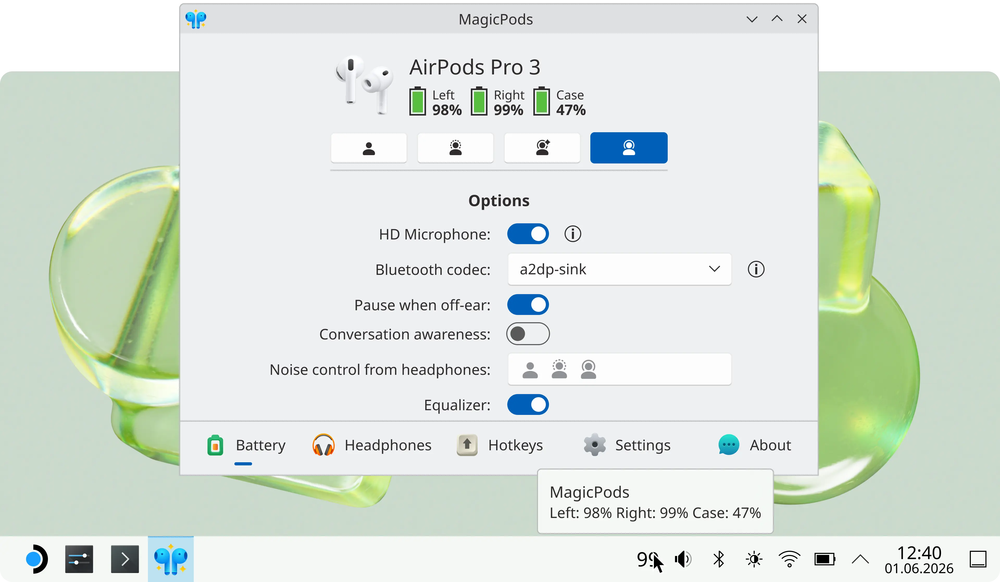

# MagicPods✨ for Linux

Control your AirPods, Beats, and compatible Galaxy Buds on Linux and SteamOS. MagicPods brings battery monitoring, noise control, and advanced headphone settings to Steam Deck, Steam Machine, and Linux desktops.

  

Tested on Kubuntu 26.04, Ubuntu 26.04, and SteamOS 3.7.24.

## 🎨 Features

- Battery Monitoring - View headphone battery levels in the app, system tray, or through the [MagicPodsDecky](https://github.com/steam3d/MagicPodsDecky) plugin for Decky Loader.
- Noise Control - Switch between noise cancellation, transparency, adaptive, and other available modes.
- Pop-Up Animation - See an iPhone-style battery animation when opening the charging case of compatible AirPods or Beats.
- Bluetooth Management - Connect and disconnect headphones, control Bluetooth, and switch audio profiles or codecs.
- System Tray - Monitor battery levels and control your headphones without opening the main window.
- Global Hotkeys - Assign keyboard shortcuts to headphone controls in Desktop Mode.
- Background Startup - Automatically launch MagicPods in the background.
- Steam Gaming Mode - Use MagicPods with a fullscreen interface optimized for SteamOS.

## 🪄 Unlock AirPods & Beats Magic

Customize your AirPods and Beats without ever needing an iPhone.

### HD Microphone

- Get significantly better microphone quality on compatible AirPods with the H2 chip compared to standard Bluetooth Hands-Free mode.

### Smart Audio

- Conversation Awareness - Automatically lower audio volume when you start speaking.
- Personalized Volume - Enable or disable personalized volume adjustments.
- Ear Detection - Automatically pause and resume playback when removing or wearing your earbuds.
- Audio Output Switching - Automatically switch between headphones and system speakers when supported.

### Noise Control

- Adaptive Audio - Adjust how much outside noise you hear.
- Noise Cancellation with One AirPod - Enable noise cancellation while wearing a single AirPod.
- Custom Noise Control Modes - Choose which modes are available when switching directly from your headphones.
- Off Listening Mode - Enable or disable the Off listening mode on compatible AirPods.

### Controls & Gestures

- Customize press-and-hold actions for each earbud.
- Adjust press speed and press-and-hold duration.
- Configure single and double presses for call controls.
- Customize volume swipe gestures.
- Change Digital Crown rotation direction on supported AirPods Max models.

### More Settings

- Custom Equalizer - Adjust bass, mids, and treble.
- Headphone Tones - Adjust the volume of built-in headphone tones.
- Optimized Charge Limit - Manage charging optimization on compatible models.
- Pause When Asleep - Configure automatic playback pausing on supported headphones.

*Available features depend on your headphone model and firmware. MagicPods automatically displays only the settings supported by your connected device.*

## 🎧 Supported Headphones

| Apple            | Beats                  | Samsung           | Google              |
| ---------------- | ---------------------- | ----------------- | ------------------- |
| AirPods 1        | PowerBeats Pro         | Galaxy Buds       | Pixel Buds A-Series |
| AirPods 2        | PowerBeats Pro 2       | Galaxy Buds Plus  | Pixel Buds Pro      |
| AirPods 3        | PowerBeats 3           | Galaxy Buds Live  | Pixel Buds Pro 2    |
| AirPods 4        | PowerBeats 4           | Galaxy Buds Pro   | Pixel Buds 2a       |
| AirPods 4 (ANC)  | Beats Fit Pro          | Galaxy Buds 2     |                     |
| AirPods 5        | Beats Studio Buds      | Galaxy Buds 2 Pro |                     |
| AirPods 5 (WCC)  | Beats Studio Buds Plus | Galaxy Buds FE    |                     |
| AirPods Pro      | Beats Studio Pro       | Galaxy Buds 3     |                     |
| AirPods Pro 2    | Beats Solo 3           | Galaxy Buds 3 Pro |                     |
| AirPods Pro 3    | Beats Solo Pro         | Galaxy Buds Core  |                     |
| AirPods Max      | Beats Studio 3         | Galaxy Buds 3 FE  |                     |
| AirPods Max 2024 | Beats X                | Galaxy Buds 4     |                     |
| AirPods Max 2    | Beats Flex             | Galaxy Buds 4 Pro |                     |
|                  | Beats Solo Buds        |                   |                     |
|                  | Beats Solo 4           |                   |                     |
|                  | Beats 360              |                   |                     |
|                  | Powerbeats Fit         |                   |                     |

## 🚀 Getting started

1. Download MagicPods from [Steam](https://store.steampowered.com/app/4486410/MagicPods_for_Linux/) or build it from source.
2. Add your headphones to the Bluetooth devices list.
3. Launch MagicPods and connect your headphones for the initial setup.
4. Done! Battery animations, charge levels, and additional settings are now available.

## 🧪 Ideas and bugs

Join the community on [Discord](https://discord.com/invite/UyY4PY768V) to suggest ideas or report issues.